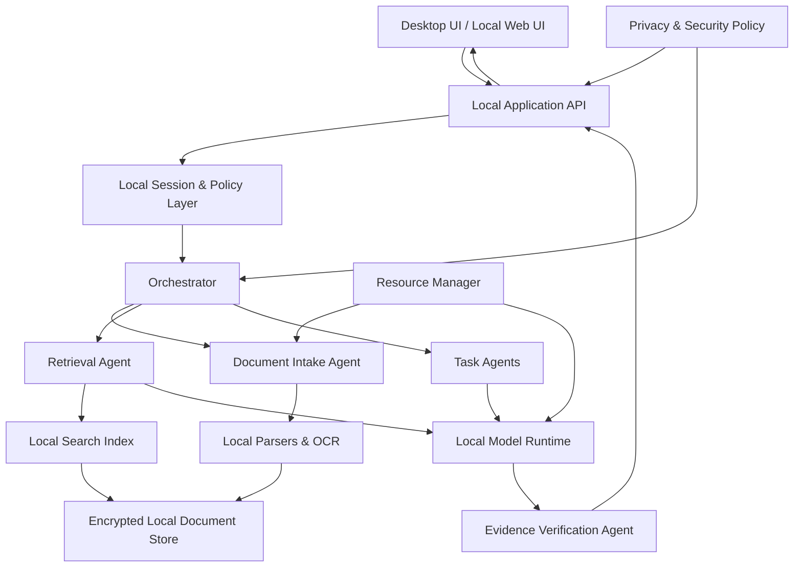

# 02 — System Architecture

## 1. Logical architecture

## 2. Recommended implementation shape

The coding agent may select equivalent libraries, but must justify changes.

### User interfaces
- Shared React + TypeScript UI.
- Desktop shell: Tauri is a strong default because it can package a web UI with a
  lightweight native shell. Evaluate platform support and sidecar packaging before committing.
- Local web: same UI served on loopback, for example `127.0.0.1`, not exposed to the LAN.
- Bundle fonts, icons, scripts and styles locally. No runtime CDN or remote asset dependency.

### Local application service
- Python + FastAPI is a reasonable default for document parsing, OCR orchestration and model
  integration. Bind only to loopback.
- Use a typed internal service layer; keep HTTP routes thin.
- Run parsing/indexing in a bounded background job queue.
- Use SQLite for metadata, job state, settings and audit events.
- Keep document binaries and derived artifacts in a managed local data directory.
- Use SQLite FTS5 for lexical retrieval. Add a local vector index only after measuring the
  value and memory/storage cost. Hybrid retrieval is preferred when feasible.

### Local model runtime
- Ollama is an acceptable initial local model adapter if it can meet offline and packaging
  requirements. Keep a provider interface so another local runtime can be substituted.
- The app must not call hosted inference endpoints.
- Runtime model selection must be hardware-aware and user-visible.
- Embedding inference and generation must both be local.
- If the model runtime is missing or unhealthy, explain how to repair it; never route to cloud.

## 3. Service boundaries

1. UI layer: presentation, local interaction, accessibility.
2. API layer: validation, session handling, request limits.
3. Orchestration layer: workflow planning and agent routing.
4. Document layer: parsers, OCR, normalization and chunking.
5. Retrieval layer: lexical/vector search, filtering, reranking.
6. Model layer: local LLM and embedding adapters.
7. Verification layer: source coverage, quote checks, conflict checks and abstention.
8. Storage layer: metadata, originals, extracted text, indexes and audit events.
9. Resource layer: memory/CPU monitoring and workload scheduling.
10. Security layer: permissions, encryption, retention and network boundary.

## 4. Request lifecycle

For a document question:
1. UI sends the question and selected collection/document scope.
2. API validates input and user access.
3. Orchestrator classifies intent and builds a bounded plan.
4. Retrieval agent searches lexical and vector indexes.
5. Retriever returns source chunks with stable IDs and metadata.
6. Context builder enforces token and source limits.
7. Local model generates a structured answer with claim-to-source references.
8. Verification agent checks references, quotations and evidence coverage.
9. If verification fails, retry once with a narrower evidence set or abstain.
10. UI renders answer, citations, uncertainty and conflicting sources.

## 5. Storage layout

Use an application-owned directory with clear separation:
- `database/` — SQLite metadata and audit database.
- `originals/` — user-imported originals.
- `extracted/` — normalized text and structured extraction artifacts.
- `indexes/` — FTS and vector index files.
- `models/` — locally installed model assets, if managed by the app.
- `temp/` — short-lived processing files, cleaned on completion/restart.
- `logs/` — redacted operational logs only.

Do not put document text, prompts containing sensitive content, or answer payloads in ordinary
logs. Define retention and deletion behavior for every derived artifact.
