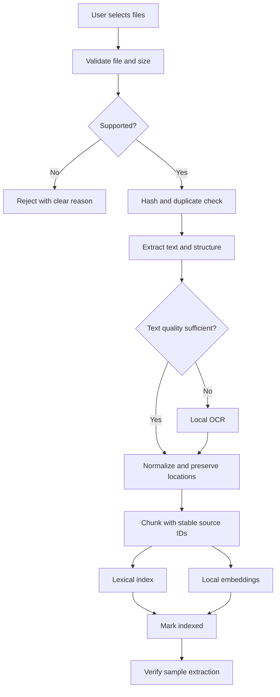

# 03 — Document Intake, Parsing and Indexing

## 1. Pipeline stages

## 2. Intake rules

- Validate extension, MIME/signature, size, page/sheet count and archive expansion limits.
- Treat file extension as untrusted; inspect file signatures.
- Reject encrypted/password-protected files unless an explicit secure password flow is designed.
- Guard against malformed files, zip bombs, macros and embedded active content.
- Never execute macros, scripts, embedded links or document instructions.
- Calculate SHA-256 for duplicate detection.
- Preserve the original file unchanged.
- Make import idempotent: retrying the same file must not create duplicate index records.

## 3. Format-specific extraction

### PDF
- Extract text and page boundaries.
- Keep page number, bounding boxes when available, and extraction method.
- Detect image-heavy/scanned pages and send only those pages to local OCR.
- Preserve reading order as best as possible; flag uncertain layouts.

### DOCX
- Extract headings, paragraphs, tables, footnotes and page-independent structural locations.
- Preserve paragraph/table identifiers. Do not invent page numbers if pagination is unavailable.

### XLSX
- Extract workbook, sheet, cell coordinates, formulas and displayed values.
- Preserve merged-cell context and row/column headers.
- Do not silently treat formulas as verified values if formula calculation is unavailable.
- Citation should point to workbook + sheet + cell/range.

### OCR
- Use a local OCR engine such as Tesseract or another evaluated offline engine.
- Record OCR confidence where available.
- Keep OCR output distinct from born-digital extracted text.
- Low-quality OCR must be flagged and should lower answer certainty.

## 4. Chunking

- Chunk by semantic structure first: heading, paragraph, table, page or worksheet region.
- Use token-aware chunk limits and modest overlap.
- Avoid splitting table headers from their rows.
- Keep stable source IDs, document version IDs and offsets.
- Every chunk must retain filename, document ID, source location, extraction method and content hash.
- Store original extracted units separately from retrieval chunks so citations can be reconstructed.

## 5. Incremental indexing

- Detect file changes through content hash, not filename or modified time alone.
- Reprocess only changed documents.
- Write new index version, validate it, then atomically switch active version.
- Keep previous index until successful commit, then clean it according to retention policy.
- If parsing fails, preserve the last known good index and clearly mark it stale.
- Deletion must remove originals and all derived text, chunks, embeddings, caches and index entries
  according to the documented deletion policy.

## 6. Resource-aware processing

- Process one document or a small bounded batch on 8 GB systems.
- Pause OCR/embedding work when memory pressure or foreground inference is high.
- Persist job checkpoints so interrupted indexing can resume.
- Avoid loading generation and embedding models simultaneously on low-memory hardware unless
  measured safe.
- Show estimated workload and allow the user to pause/cancel.
